<div align="center">


# Astian Maps for Android

Native maps, search and turn-by-turn navigation with a community status report. Offline regions, on-device voice, Android Auto.

</div>

Package `org.astian.suite.maps`. Kotlin, Jetpack Compose and MapLibre Native, with no Google SDK
and no Play Services. It is a derivative of Vela (GPL-3.0); see [NOTICE.md](NOTICE.md) for the
attribution and what Astian changed.

## Screenshots

All screenshots use the built-in location simulator, in Davis, California.

### Map, places and search

<table>
  <tr>
    <td align="center">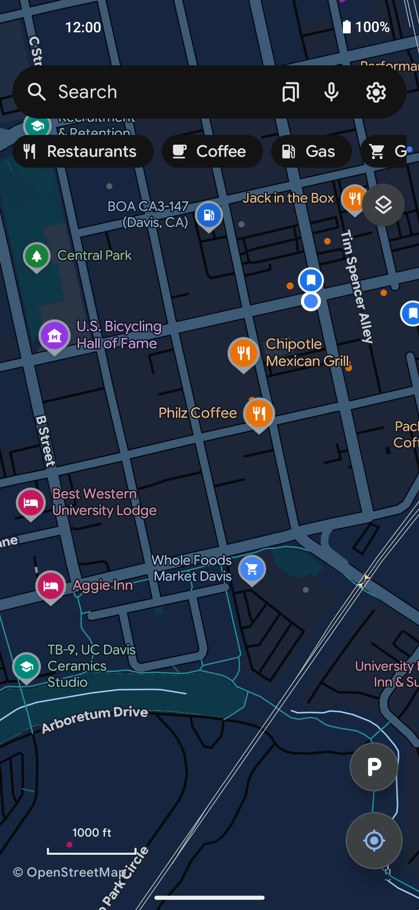</td>
    <td align="center">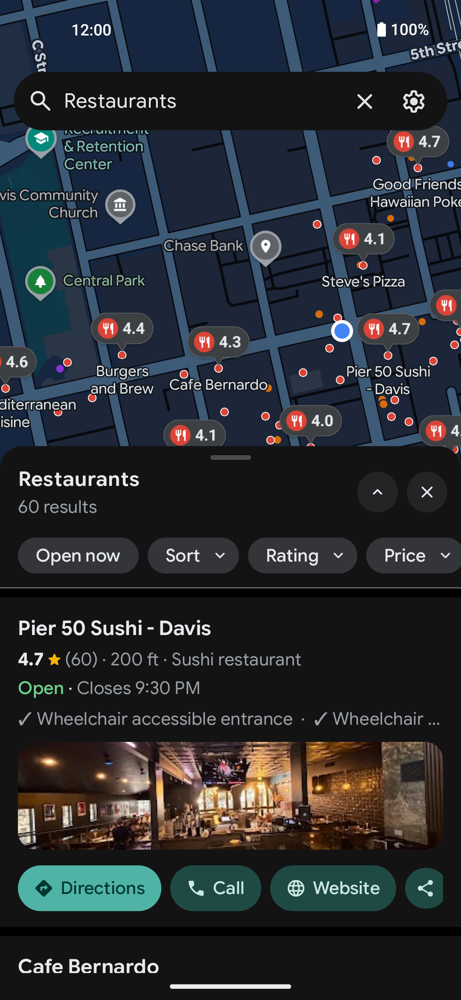</td>
    <td align="center">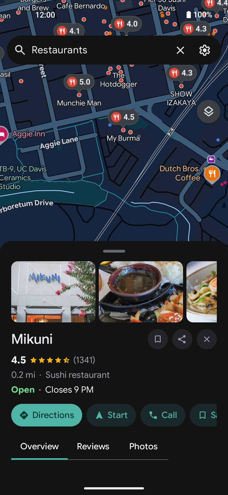</td>
    <td align="center">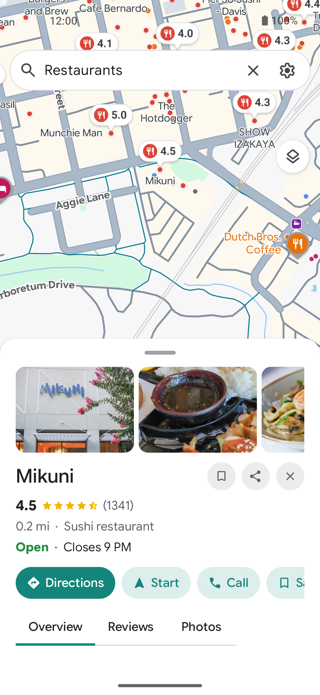</td>
  </tr>
  <tr>
    <td align="center">Map and quick categories</td>
    <td align="center">Search</td>
    <td align="center">Place page</td>
    <td align="center">Light theme</td>
  </tr>
</table>

### Community reports

Report traffic, police, a crash, a hazard, a pothole, roadworks, a closure, weather or a camera
in two taps. Reports reach every phone and the [web map](https://github.com/goastian/astian-maps-web)
as they are sent; the web only shows them. No account, no name.

<table>
  <tr>
    <td align="center"></td>
    <td align="center">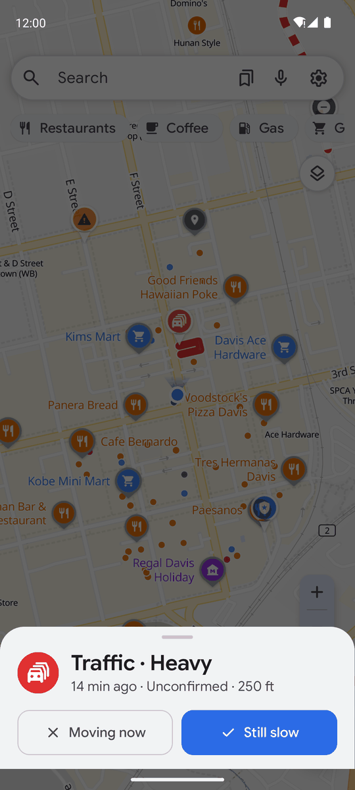</td>
    <td align="center"></td>
    <td align="center"></td>
  </tr>
  <tr>
    <td align="center">Reports on the map</td>
    <td align="center">Confirm a report</td>
    <td align="center">Make a report</td>
    <td align="center">All types, dark map</td>
  </tr>
</table>

### Directions and navigation

<table>
  <tr>
    <td align="center"></td>
    <td align="center">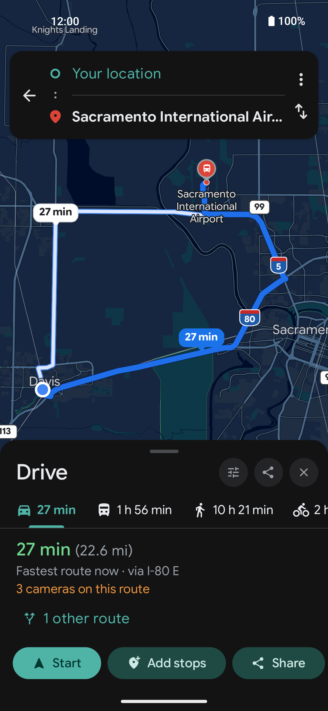</td>
    <td align="center">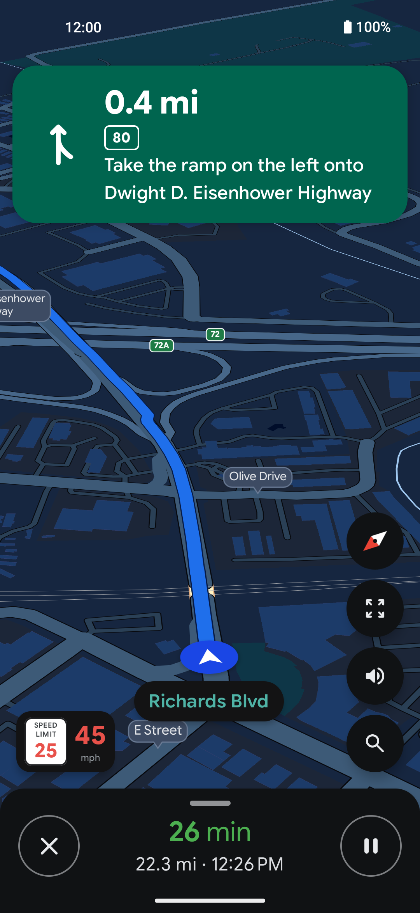</td>
    <td align="center"></td>
  </tr>
  <tr>
    <td align="center">Drive, transit, walk, bike</td>
    <td align="center">Alternatives</td>
    <td align="center">Turn-by-turn</td>
    <td align="center">Report ahead</td>
  </tr>
</table>

### Transit, layers and themes

<table>
  <tr>
    <td align="center">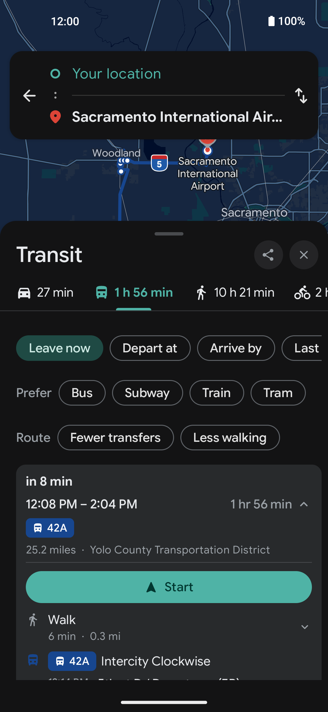</td>
    <td align="center">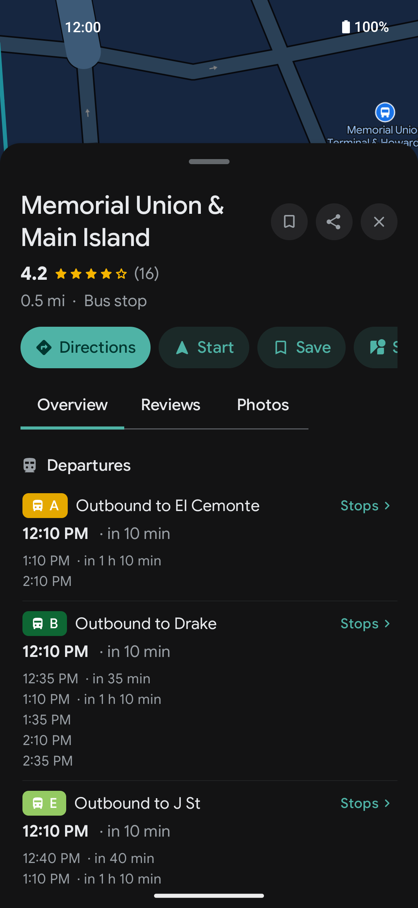</td>
    <td align="center">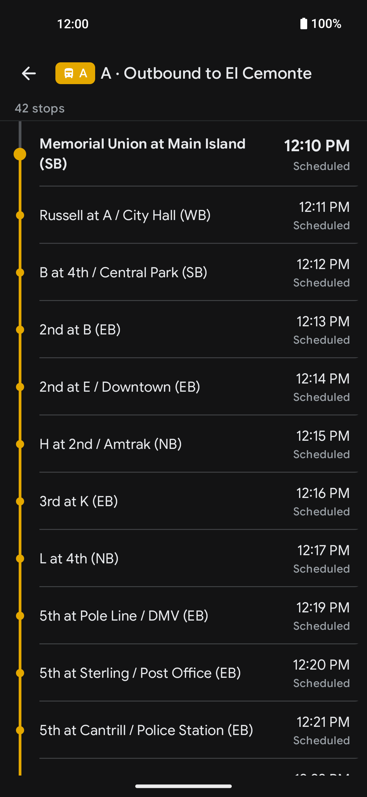</td>
    <td align="center">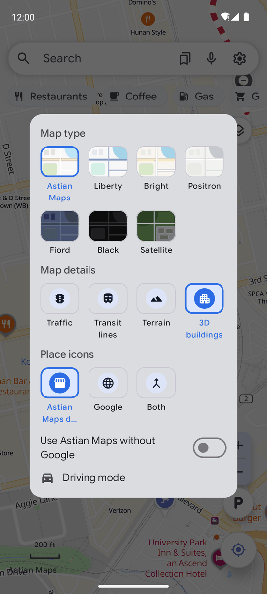</td>
  </tr>
  <tr>
    <td align="center">Transit routes</td>
    <td align="center">Stop departures</td>
    <td align="center">Line stops</td>
    <td align="center">Map types and layers</td>
  </tr>
</table>

## What it does

[FEATURES.md](FEATURES.md) lists every feature in one line each; [SPEC.md](SPEC.md) and
[docs/book/](docs/book/README.md) explain how they work. In short: an open vector map, place
pages, search, driving, walking, cycling and transit routes, durable turn-by-turn navigation
with lane guidance and spoken directions, offline map/search/routing by region, saved places
and lists, and an Android Auto session.

How the app reaches the network, request by request, is in [PRIVACY.md](PRIVACY.md).

## Build and install

```bash
scripts/fetch-build-deps.sh       # once: prebuilt runtime binaries that are not in git
./gradlew :app:assembleRelease    # R8 build; signed with the debug key unless ASTIAN_KEYSTORE_PATH is set
scripts/dev-install.sh            # same build plus adb install, with the dev data catalogs
```

[docs/BUILDING.md](docs/BUILDING.md) has the details, the tests and signing.

## Where it fits in the monorepo

`apps/android` is the mobile client. The shared contracts, the API (`services/api`) and the web
client ([goastian/astian-maps-web](https://github.com/goastian/astian-maps-web)) live beside it; the plan that orders the work is [docs/plan_maps.md](../../docs/plan_maps.md).

## Project links

Every address the app has of its own project (repository, releases, data catalogs, site) is in
`core/src/main/java/org/astian/suite/maps/core/config/AstianLinks.kt`. Until Astian publishes
its own data catalogs, `scripts/dev-install.sh` points a build at the upstream project's.

## License

GPL-3.0, see [LICENSE](LICENSE).
